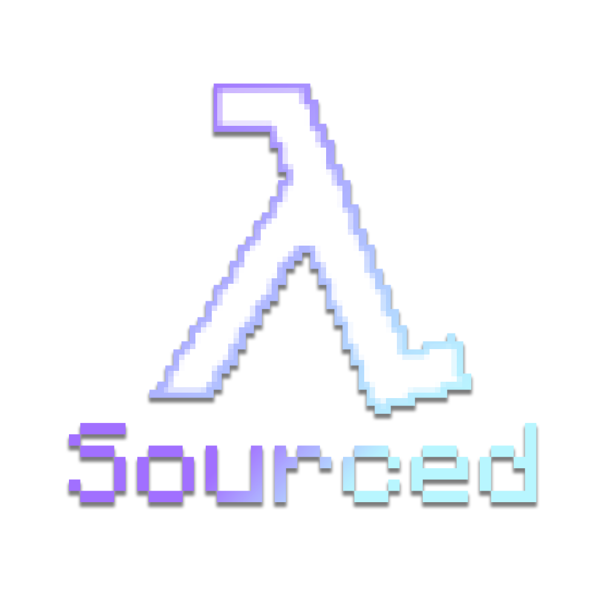

<h1 align="center">



<br>Sourced

</h1>

<p align="center">

Reimplementation of Half-Life and Quake movement for Minecraft 1.21.1 on NeoForge.

</p>

Four movement presets, switchable in game. Bunnyhopping, air strafing, trimping and sharking. Every
value is adjustable from a config screen and applies without a restart.

## Presets


| Preset                    | Modelled on                              | Commands per tick | Air budget | Distinguishing feature                                 |
| ------------------------- | ---------------------------------------- | ----------------- | ---------- | ------------------------------------------------------ |
| **HL1 Movement (Source)** | the HL1 Movement mod for Half-Life 2     | 3 (60 Hz)         | 90 u/s     | Default. Uncapped hop, no jump boost, no edge friction |
| Half-Life                 | Half-Life                                | 5 (100 Hz)        | 150 u/s    | Edge friction applies. Widest steering budget          |
| Half-Life 2               | Half-Life 2, with the jump forward boost | 3 (60 Hz)         | 90 u/s     | Accelerated back hopping                               |
| Quake                     | the Squake algorithm                     | 1                 | 39.4 u/s   | Soft and hard caps                                     |


The games these presets follow update movement 60 to 100 times a second, not once per 20 Hz tick.
Each preset emulates that with a fixed command count per tick, so steering does not follow frame
rate.

The three Half-Life presets share vanilla gravity and a jump solved for a 1.25 block apex. They
differ horizontally, not vertically.

## Features

- Bunnyhopping with auto-hop
- Air strafing
- Trimping: crouch as you jump to trade horizontal speed for height
- Sharking: keep speed skimming the surface of water
- Accelerated back hopping in the Half-Life 2 preset
- Speed readout under the crosshair, coloured by gain or loss
- Statistics for distance bunnyhopped, distance sharked and trimps performed
- Ice, slime, honey, soul sand, Speed potions, Soul Speed, Jump Boost, Levitation and Slow Falling
keep working

### Speed-gain falloff feature

Keeps bunnyhopping balanced in survival without flattening the feel: the
faster you are, the less each gain adds, and it never takes back speed you earned.

Exponential curve. Four curves, two thresholds. Inverse and Exponential never reach zero. Quadratic and Linear become a hard cap one scale above the onset.

## Requirements


|                                                               | Version                         |
| ------------------------------------------------------------- | ------------------------------- |
| Minecraft                                                     | 1.21.1                          |
| NeoForge                                                      | 21.1.248 or newer (`[21.1.0,)`) |
| [Kotlin for Forge](https://modrinth.com/mod/kotlin-for-forge) | 5.12.0 or newer (`[5.12.0,6)`)  |
| [YetAnotherConfigLib](https://modrinth.com/mod/yacl)          | 3.6.0 or newer, client only     |


Kotlin for Forge supplies `kotlin-stdlib`, `kotlin-reflect`, `kotlinx-coroutines` and
`kotlinx-serialization` at runtime. Nothing Kotlin-related is shaded into this jar.

## Client and server

Works client side alone, on any server that does not run it. Each player chooses whether it is on.

Install it on the server too if landings should stop cancelling runs: fall damage applies its knockback server side, and only a server copy prevents that from eating carried speed.

## Configuration

Open the screen from the mod list, or bind a key. Settings live in `config/sourced.json`, which
records only values changed from their defaults.

Three keybinds ship unbound: toggle the mod, open the config screen, cycle the preset. Bind them
under Controls. A preset picked with the key is saved immediately.

Three tabs:

- **General**: active preset, trimping, sharking, speed readout and its colours
- **Constants**: values used by the Quake preset, trimping and sharking
- **Half-Life**: behaviour flags shared by the three Half-Life presets, then one collapsed group per
preset holding its own values

## Building

Requires JDK 21. From the repository root:

```
./gradlew build
```

The jar lands in `build/libs/`. `./gradlew runClient` starts a development client,
`./gradlew runServer` a dedicated server.

## Credits

Sourced is a rebranded fork of re:squake, itself a rewrite of Squake.

- [polina4096](https://github.com/polina4096) for [re:squake](https://github.com/polina4096/resquake), the Kotlin rewrite this is built on
- [Tlesis](https://github.com/Tlesis) and [LeviOP](https://github.com/LeviOP) for the [SquakePlusPlus fork](https://github.com/Tlesis/SquakePlusPlus)
- [He11crow](https://github.com/He11crow) for [porting](https://github.com/He11crow/SquakeFabric) the original to Fabric [(Modrinth)](https://modrinth.com/mod/squakefabric)
- [squeek502](https://github.com/squeek502) for the [original Squake](https://github.com/squeek502/Squake) [(CurseForge)](https://www.curseforge.com/minecraft/mc-mods/squake)

The default values of the HL1 Movement preset follow the console-variable defaults of the
"HL1 Movement" build of the ghosting-renewed project.

## License

MIT. Copyright (c) 2026 nikenmar. See [LICENSE](LICENSE).

<details open>
<summary><b>Disclaimer</b></summary>

> *Sourced is an unofficial project, not affiliated with, endorsed by, or associated with Valve Corporation or id Software. "Half-Life", "Source" and "Valve" are trademarks of Valve Corporation. "Quake" and "id Software" are trademarks of id Software LLC.*

</details>

